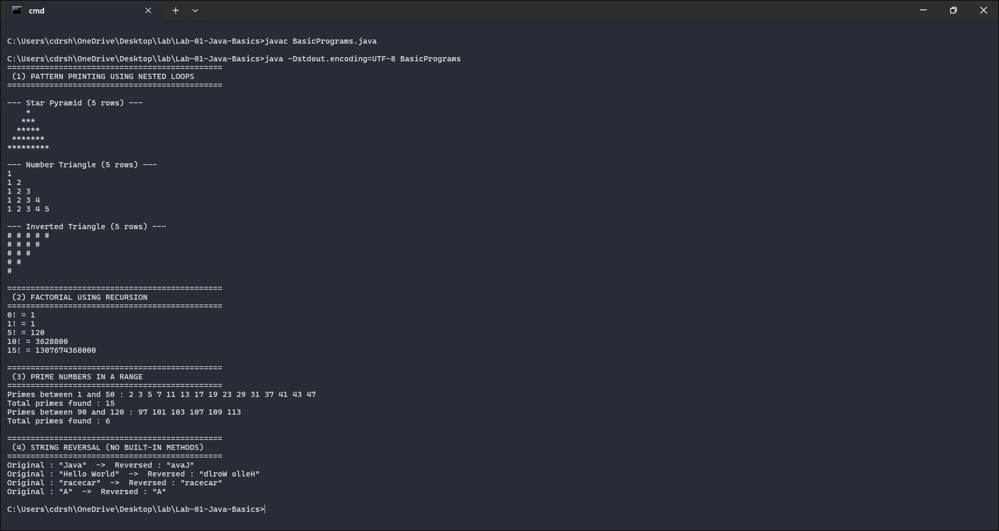

# Lab 01 - Java Basics

Four small programs covering the fundamentals: printing patterns with nested loops, factorial by recursion, finding primes in a range, and reversing a string by hand without any library method.

Course outcome CO1 (understand the Java environment and basic constructs), Bloom level K2.

## Files

- `BasicPrograms.java` - all four programs, each in its own method called from `main`
- `output.txt` - the program output
- `screenshots/output-1.png` - screenshot of the output

## Running it

```
javac BasicPrograms.java
java BasicPrograms
```

## How the code works

**Patterns.** Three patterns are drawn - a star pyramid, a number triangle, and an inverted triangle. They all use the same idea: the outer loop runs once per row, and the inner loops print the spaces and symbols for that row. For the centered pyramid, row `i` needs `rows - i` leading spaces and `2*i - 1` stars, so the whole thing is really just that bit of arithmetic inside two loops.

**Factorial.** Done with recursion. The method calls itself with a smaller number until it hits the base case (`n <= 1` returns 1), so `factorial(5)` unwinds to `5 * 4 * 3 * 2 * 1`. The return type is `long` because `13!` already overflows an `int`.

**Primes.** For each number in the range, trial division checks for a factor. The loop only goes up to the square root of `n` - if a number had a factor larger than its square root, the matching factor would be smaller than the square root and we'd have already found it. That turns an O(n) check into O(sqrt n).

**String reversal.** No `StringBuilder.reverse()` or anything like it. It copies characters into a new array starting from the end of the string and working back to the front, then builds a string from that array.

## Screenshot



## Output

```text
--- Star Pyramid (5 rows) ---
    *
   ***
  *****
 *******
*********

0! = 1
5! = 120
15! = 1307674368000

Primes between 1 and 50 : 2 3 5 7 11 13 17 19 23 29 31 37 41 43 47
Total primes found : 15

Original : "Hello World"  ->  Reversed : "dlroW olleH"
Original : "racecar"  ->  Reversed : "racecar"
```

The full output is in `output.txt`. A couple of things worth noting: `0!` and `1!` both return 1 (the base case), `15!` shows why `long` was needed, and "racecar" reversing to itself is a quick palindrome sanity check.
