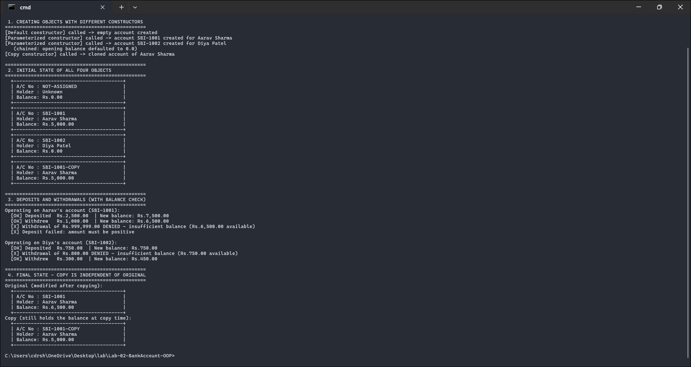

# Lab 02 - BankAccount (OOP Fundamentals)

A `BankAccount` class with account number, holder name, and balance, demonstrating the three kinds of constructor, deposit and withdraw with a balance check, and constructor overloading.

Course outcome CO1 (implement OOP fundamentals with classes, objects, and constructors), Bloom level K3.

## Files

- `BankAccountDemo.java` - the `BankAccount` class plus a `BankAccountDemo` driver
- `output.txt` - the program output
- `screenshots/output-1.png` - screenshot of the output

## Running it

```
javac BankAccountDemo.java
java BankAccountDemo
```

## How the code works

The class has four constructors, which is the overloading the lab asks for - same name, different parameter lists, and the compiler picks the right one by signature:

- a default constructor that fills in safe placeholder values,
- a parameterized one that takes account number, holder, and an opening balance,
- a shorter one that takes just account number and holder and chains to the parameterized version with `this(...)`, defaulting the balance to zero,
- a copy constructor that takes another `BankAccount` and clones its state (it appends `-COPY` to the number so the clone is easy to tell apart).

`withdraw` has the balance check the syllabus wants: if the amount is more than the balance it refuses and leaves the account untouched. Negative deposits and withdrawals are rejected too. The fields are `private` and the only way to change the balance is through these methods, so the object keeps its own rules intact - that's the point of encapsulation.

## Screenshot



## Output

```text
[Default constructor] called -> empty account created
[Parameterized constructor] called -> account SBI-1001 created for Aarav Sharma
[Parameterized constructor] called -> account SBI-1002 created for Diya Patel
   (chained: opening balance defaulted to 0.0)
[Copy constructor] called -> cloned account of Aarav Sharma

Operating on Aarav's account (SBI-1001):
  [OK] Deposited  Rs.2,500.00  | New balance: Rs.7,500.00
  [OK] Withdrew   Rs.1,000.00  | New balance: Rs.6,500.00
  [X] Withdrawal of Rs.999,999.00 DENIED - insufficient balance (Rs.6,500.00 available)
  [X] Deposit failed: amount must be positive
```

Things the run shows: all four constructors fire (you can see a different message for each), the `(chained: ...)` line prints after the parameterized message which proves `this(...)` runs the target constructor first, the oversized withdrawal is denied, and at the end the copy still holds Rs.5,000 while the original has grown to Rs.6,500 - so the two objects are independent.

## Likely viva questions

- **Does Java have a built-in copy constructor like C++?** No. You write one yourself that takes the same type as a parameter.
- **What makes constructors overloaded?** Same name, different parameter lists. The compiler resolves the call by signature.
- **Why are the fields private?** So the balance can only change through `deposit` and `withdraw`, which enforce the rules.
- **What if you write no constructor at all?** The compiler gives you a no-argument default. Writing any constructor yourself removes that freebie.
