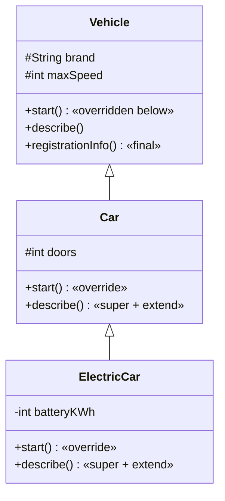
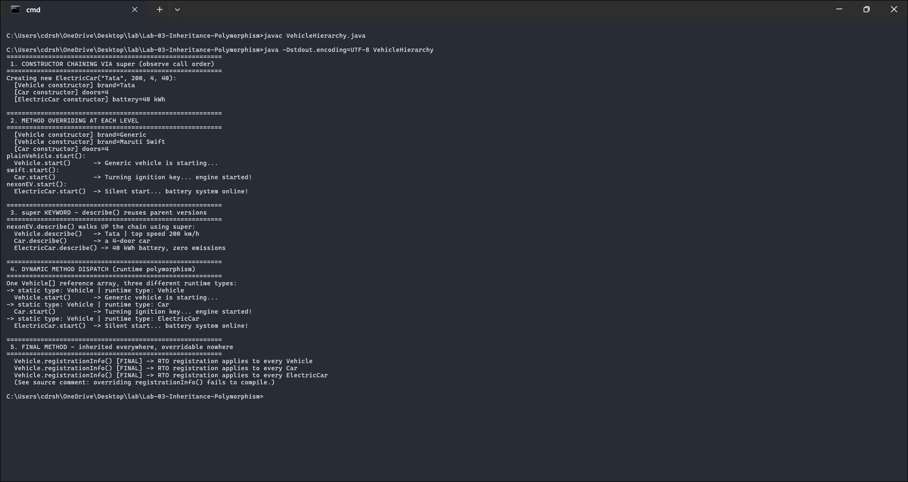

<div align="center">

# 🚗 Lab 03 — Multilevel Inheritance & Polymorphism

### *Vehicle → Car → ElectricCar · overriding · `super` · dynamic dispatch · `final` methods*


</div>

---

## 🎯 Aim

Design a **multilevel** class hierarchy and demonstrate:

- ✅ Method **overriding at each level**
- ✅ The **`super`** keyword (constructor chaining *and* calling parent methods)
- ✅ **Dynamic method dispatch** (runtime polymorphism)
- ✅ A **`final` method** in the base class, with its behaviour verified



---

## 📁 Files

| File | Purpose |
|------|---------|
| `VehicleHierarchy.java` | `Vehicle`, `Car`, `ElectricCar` + driver class |
| `output.txt` | Actual captured program output |
| `README.md` | You are here 👋 |

---

## ⚙️ How to Run

```bash
javac VehicleHierarchy.java
java VehicleHierarchy
```

---

## 🔍 How the Code Works

### `super` does two different jobs

```java
ElectricCar(String brand, int maxSpeed, int doors, int batteryKWh) {
    super(brand, maxSpeed, doors);   // job 1: chain UP to Car → Vehicle constructors
    ...
}

@Override
void describe() {
    super.describe();                // job 2: reuse the PARENT's method, then extend it
    System.out.println("... kWh battery, zero emissions");
}
```

Creating one `ElectricCar` prints **three** constructor messages — `Vehicle` → `Car` → `ElectricCar` — proving the chain always runs top-down.

### Dynamic method dispatch — the heart of polymorphism

```java
Vehicle[] garage = { plainVehicle, swift, nexonEV };  // one STATIC type…
for (Vehicle v : garage)
    v.start();   // …three different methods actually run (picked at RUNTIME)
```

The compiler only knows `v` is a `Vehicle`; the **JVM** looks at the real object at runtime and calls *its* override. That's dynamic dispatch.

### The `final` method — verified

```java
final void registrationInfo() { ... }   // in Vehicle
```

Every subclass **inherits** and can call it, but none may override it. The source contains the proof as a comment — un-commenting the override attempt in `Car` yields:

```text
error: registrationInfo() in Car cannot override registrationInfo() in Vehicle;
       overridden method is final
```

---

## 📸 Live Terminal Screenshot

> Genuine screenshot of `VehicleHierarchy` compiled with `javac` and run in Windows Terminal on Windows 11 (JDK 17) — not a mock-up.



---

## 📟 Output (actual run)

```text
Creating new ElectricCar("Tata", 200, 4, 40):
  [Vehicle constructor] brand=Tata
  [Car constructor] doors=4
  [ElectricCar constructor] battery=40 kWh

-> static type: Vehicle | runtime type: Vehicle
  Vehicle.start()      -> Generic vehicle is starting...
-> static type: Vehicle | runtime type: Car
  Car.start()          -> Turning ignition key... engine started!
-> static type: Vehicle | runtime type: ElectricCar
  ElectricCar.start()  -> Silent start... battery system online!
```

<details>
<summary>📜 <b>Click for the FULL captured output</b> (also in <code>output.txt</code>)</summary>

See [`output.txt`](./output.txt) — constructor chaining, overriding at each level, the three-level `super.describe()` walk, dynamic dispatch over the `Vehicle[]` array, and the inherited `final` method running on all three objects.

</details>

### 🧾 What the output proves

| Observation | Concept verified |
|-------------|------------------|
| 3 constructor lines for 1 `new ElectricCar(...)` | `super(...)` chains constructors through every level |
| `nexonEV.describe()` prints Vehicle's, then Car's, then ElectricCar's line | `super.method()` climbs the hierarchy level by level |
| Same `v.start()` call, three different outputs | **Dynamic dispatch** — runtime type wins, not the reference type |
| `registrationInfo()` runs for all three objects | `final` methods are inherited everywhere, overridable nowhere |

---

## 🎤 Viva-Voce Quick Prep

| Question | Answer |
|----------|--------|
| Multilevel vs multiple inheritance? | Multilevel = A→B→C chain (Java ✓). Multiple = one class, two parents (Java ✗ for classes — use interfaces). |
| When is the overridden method chosen? | At **runtime**, from the object's actual class (late binding). |
| Can a constructor be `final`? | No — constructors are never inherited, so `final` is meaningless there. |
| Why make a method `final`? | To lock critical behaviour against modification, and to enable certain JVM optimizations. |
