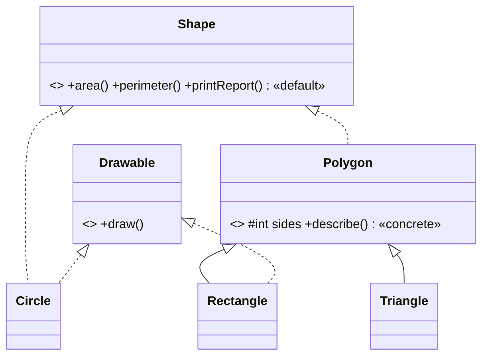

<div align="center">

# 📐 Lab 04 — Interfaces & Abstract Classes

### *`Shape` interface · `Polygon` abstract class · multiple interface implementation*


</div>

---

## 🎯 Aim

- ✅ Interface **`Shape`** with abstract methods `area()` and `perimeter()`, implemented by **Circle, Rectangle, Triangle**
- ✅ Abstract class **`Polygon`** with a **concrete** `describe()` method
- ✅ **Multiple interface implementation** (`Shape` + `Drawable`)
- ✅ A **driver class** comparing interface vs abstract-class behaviour



---

## 📁 Files

| File | Purpose |
|------|---------|
| `ShapeDemo.java` | Interfaces, abstract class, 3 shapes + driver class |
| `output.txt` | Actual captured program output |
| `README.md` | You are here 👋 |

---

## ⚙️ How to Run

```bash
javac ShapeDemo.java
java ShapeDemo
```

---

## 🔍 How the Code Works

### The contract (interface)

```java
interface Shape {
    double area();        // every shape MUST say how to compute these…
    double perimeter();
    default void printReport() { ... }   // …and gets this report method for free
}
```

### The partial implementation (abstract class)

```java
abstract class Polygon implements Shape {
    protected int sides;                 // STATE — something an interface can't hold
    void describe() { ... }              // CONCRETE method inherited by subclasses
}
```

`Rectangle` and `Triangle` extend `Polygon` (they are genuine polygons); `Circle` implements `Shape` directly (a circle has no sides). The type hierarchy mirrors reality — that's **modular design**.

### Multiple interface implementation

```java
class Circle implements Shape, Drawable { ... }               // two at once
class Rectangle extends Polygon implements Drawable { ... }   // extends + implements
```

A Java class gets **one** superclass but **any number** of interfaces — the demo shows both routes to the same capability.

### Triangle's area — Heron's formula

```java
double s = perimeter() / 2;                       // semi-perimeter
return Math.sqrt(s * (s-a) * (s-b) * (s-c));      // works for ANY valid triangle
```

---

## 📸 Live Terminal Screenshot

> Genuine screenshot of `ShapeDemo` compiled with `javac` and run in Windows Terminal on Windows 11 (JDK 17) — not a mock-up.


---

## 📟 Output (actual run)

```text
 1. INTERFACE CONTRACT — area() & perimeter() for each shape
  Circle     | area =      78.54 | perimeter =      31.42
  Rectangle  | area =      24.00 | perimeter =      22.00
  Triangle   | area =       6.00 | perimeter =      12.00

 2. ABSTRACT CLASS — concrete describe() inherited by subclasses
  I am a Rectangle, a polygon with 4 sides.
  I am a Triangle, a polygon with 3 sides.

 3. MULTIPLE INTERFACE IMPLEMENTATION — Shape + Drawable
  Drawing Circle    : ( O )  radius=5.0
  Drawing Rectangle : [=====]  8.0 x 3.0
```

<details>
<summary>📜 <b>Click for the FULL captured output</b> (also in <code>output.txt</code>)</summary>

See [`output.txt`](./output.txt) — includes section 4, the observed interface-vs-abstract-class comparison.

</details>

### 🧾 What the output proves

| Observation | Concept verified |
|-------------|------------------|
| Circle area 78.54 (= π·5²), Triangle area 6.00 (3-4-5 right triangle) | The interface contract is implemented correctly by each class |
| `describe()` runs in Rectangle/Triangle without being written there | Abstract classes pass **concrete** behaviour down |
| One `Shape[]` array held all three shapes | Interfaces give polymorphism, just like superclasses |
| Circle draws *and* reports | One class can honour **multiple** interfaces |

---

## ⚖️ Interface vs Abstract Class — one-glance table

| | Interface `Shape` | Abstract class `Polygon` |
|---|---|---|
| State (fields) | ❌ only `public static final` constants | ✅ real instance fields (`sides`) |
| Concrete methods | `default`/`static` only | ✅ any number |
| Constructors | ❌ | ✅ (called via `super`) |
| How many can a class take? | **Many** (`implements A, B, …`) | **One** (`extends`) |
| Use when… | unrelated classes share a *capability* | related classes share *code + state* |

---

## 🎤 Viva-Voce Quick Prep

| Question | Answer |
|----------|--------|
| Can you instantiate an interface or abstract class? | No — only concrete subclasses/implementations. |
| What is a `default` method? | A method **with a body** inside an interface (Java 8+) that implementers inherit. |
| Why is `PI` in the interface automatically constant? | Interface fields are implicitly `public static final`. |
| Diamond problem in Java? | Two interfaces with the same default method force the class to override it — conflict resolved explicitly. |
