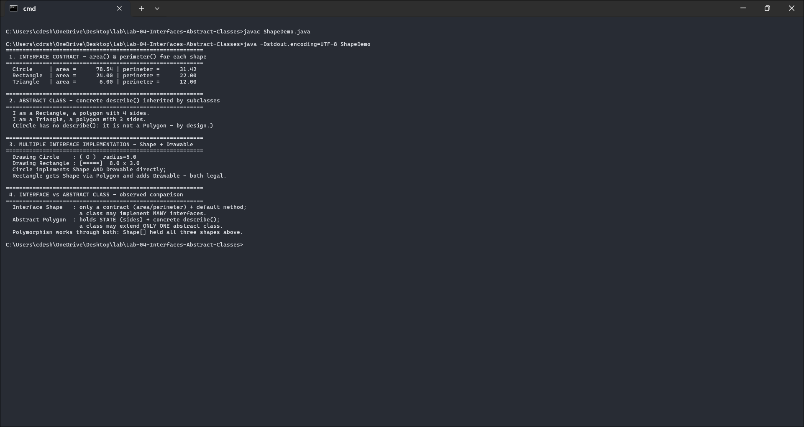

# Lab 04 - Interfaces and Abstract Classes

A `Shape` interface with `area()` and `perimeter()`, implemented by `Circle`, `Rectangle`, and `Triangle`; an abstract `Polygon` class with a concrete `describe()` method; a class implementing two interfaces at once; and a driver that compares how interfaces and abstract classes behave.

Course outcome CO2 (apply interfaces and abstract classes for modular design), Bloom level K3.

## Files

- `ShapeDemo.java` - the interfaces, the abstract class, three shapes, and a driver
- `output.txt` - the program output
- `screenshots/output-1.png` - screenshot of the output

## Running it

```
javac ShapeDemo.java
java ShapeDemo
```

## How the code works

`Shape` is the contract: any class that implements it must provide `area()` and `perimeter()`. It also has a `default` method, `printReport()`, which has a body that every implementer inherits for free.

`Polygon` is abstract and implements `Shape`. It holds a field (`sides`) and a concrete `describe()` method - things an interface can't really do. `Rectangle` and `Triangle` extend `Polygon` because they genuinely are polygons, while `Circle` implements `Shape` directly since a circle has no sides. Lining the types up with reality like this is what the "modular design" in the outcome means.

Implementing two interfaces is shown by `Circle`, which is both a `Shape` and a `Drawable`. `Rectangle` does it the other way - it extends `Polygon` (getting `Shape` through it) and adds `Drawable`. A class gets one superclass but any number of interfaces, and the demo shows both routes.

The triangle's area uses Heron's formula so it works for any valid triangle, not just right triangles.

## Screenshot



## Output

```text
 1. INTERFACE CONTRACT - area() & perimeter() for each shape
  Circle     | area =      78.54 | perimeter =      31.42
  Rectangle  | area =      24.00 | perimeter =      22.00
  Triangle   | area =       6.00 | perimeter =      12.00

 2. ABSTRACT CLASS - concrete describe() inherited by subclasses
  I am a Rectangle, a polygon with 4 sides.
  I am a Triangle, a polygon with 3 sides.

 3. MULTIPLE INTERFACE IMPLEMENTATION - Shape + Drawable
  Drawing Circle    : ( O )  radius=5.0
  Drawing Rectangle : [=====]  8.0 x 3.0
```

The circle's area is 78.54 (pi*5^2) and the triangle's is 6.00 (a 3-4-5 right triangle), so the implementations are correct. `describe()` runs in the subclasses without being written there, which shows an abstract class passing concrete behaviour down. The driver holds all three shapes in one `Shape[]`, so polymorphism works through the interface just like it would through a superclass.

## Interface vs abstract class

| | interface `Shape` | abstract class `Polygon` |
|---|---|---|
| instance fields | no (only constants) | yes (`sides`) |
| concrete methods | only `default`/`static` | any number |
| constructors | no | yes |
| how many per class | many | one |
| use when | unrelated classes share a capability | related classes share code and state |
