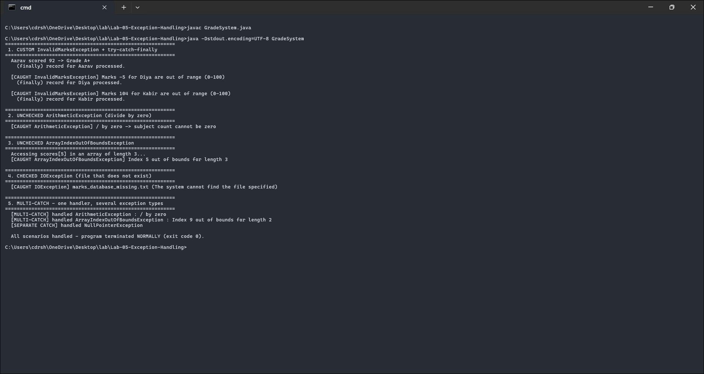

# Lab 05 - Exception Handling

A small student grade system that demonstrates a custom exception, try-catch-finally, multi-catch, throw and throws, and the difference between checked and unchecked exceptions.

Course outcome CO3 (implement robust exception handling), Bloom level K3.

## Files

- `GradeSystem.java` - the custom exception and five scenarios
- `output.txt` - the program output
- `screenshots/output-1.png` - screenshot of the output

## Running it

```
javac GradeSystem.java
java GradeSystem
```

## How the code works

`InvalidMarksException` extends `Exception`, which makes it a checked exception - the compiler won't let a caller ignore it. The `computeGrade` method declares `throws InvalidMarksException` in its signature and uses `throw` to raise one when the marks fall outside 0-100. So `throws` is the warning on the method and `throw` is the thing that actually fires.

There are five scenarios:

1. Valid and invalid marks, caught with try-catch and a `finally` block that runs either way.
2. An `ArithmeticException` from dividing by zero (averaging over zero subjects).
3. An `ArrayIndexOutOfBoundsException` from reading past the end of an array.
4. An `IOException` from opening a file that doesn't exist - the compiler forces this one to be handled, which is what "checked" means.
5. A single try block that can fail three different ways, handled by a multi-catch (`catch (A | B e)`) plus a separate catch for `NullPointerException`.

The `finally` line prints after both the success case and the failure cases, which is the thing to notice about `finally` - it runs no matter what.

## Screenshot



## Output

```text
  Aarav scored 92 -> Grade A+
    (finally) record for Aarav processed.

  [CAUGHT InvalidMarksException] Marks -5 for Diya are out of range (0-100)
    (finally) record for Diya processed.

  [CAUGHT ArithmeticException] / by zero -> subject count cannot be zero
  [CAUGHT ArrayIndexOutOfBoundsException] Index 5 out of bounds for length 3
  [CAUGHT IOException] marks_database_missing.txt (The system cannot find the file specified)

  [MULTI-CATCH] handled ArithmeticException : / by zero
  [MULTI-CATCH] handled ArrayIndexOutOfBoundsException : Index 9 out of bounds for length 2
  [SEPARATE CATCH] handled NullPointerException

  All scenarios handled - program terminated NORMALLY (exit code 0).
```

Every exception is caught and the program still exits cleanly, which is the point - handled exceptions don't crash anything.

## Checked vs unchecked

Checked exceptions extend `Exception` (but not `RuntimeException`) and the compiler forces you to handle them - they stand for recoverable outside failures like missing files. In this lab that's `InvalidMarksException` and `IOException`. Unchecked exceptions extend `RuntimeException` and usually mean a bug - divide by zero, bad array index, null reference. Here those are `ArithmeticException`, `ArrayIndexOutOfBoundsException`, and `NullPointerException`.
