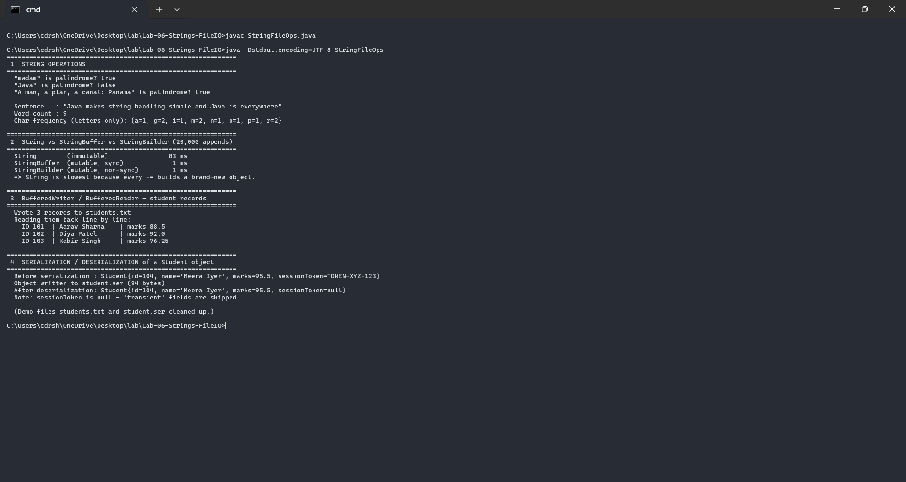

# Lab 06 - Strings and File I/O

Four parts: string operations (palindrome, word count, character frequency), a speed comparison of `String` vs `StringBuffer` vs `StringBuilder`, writing and reading student records with buffered I/O, and serializing an object to a file and back.

Course outcome CO3 (string operations and file I/O), Bloom level K3.

## Files

- `StringFileOps.java` - all four parts plus a serializable `Student` class
- `output.txt` - the program output
- `screenshots/output-1.png` - screenshot of the output

The program creates `students.txt` and `student.ser` while it runs and deletes them at the end, so the folder stays clean.

## Running it

```
javac StringFileOps.java
java StringFileOps
```

## How the code works

**String operations.** The palindrome check strips out anything that isn't a letter or digit, lowercases the rest, and compares with two pointers moving in from both ends, so "A man, a plan, a canal: Panama" comes out true. Word count splits on runs of whitespace. Character frequency counts letters into a `TreeMap` so the result comes out sorted.

**The speed comparison.** The program appends a single character 20,000 times, three ways. `String` is slow because strings are immutable - every `+=` builds a brand-new object, so the total work is O(n^2). `StringBuffer` and `StringBuilder` append into an internal array instead, which is O(n). `StringBuffer` is synchronized (thread-safe) and `StringBuilder` isn't, which is why `StringBuilder` is the usual choice in single-threaded code. The exact times vary per run, but the gap between `String` and the other two is large and grows with the count.

**Buffered I/O.** Records are written with `BufferedWriter` and read back with `BufferedReader`, both inside try-with-resources so the streams always close. Buffering batches lots of small writes into a few disk operations.

**Serialization.** A `Student` object is written to a file with `ObjectOutputStream` and read back with `ObjectInputStream`. The `sessionToken` field is marked `transient`, so it isn't written and comes back as `null` - that's the thing to notice.

## Screenshot



## Output

```text
  "madam" is palindrome? true
  "A man, a plan, a canal: Panama" is palindrome? true

  Word count : 9
  Char frequency (letters only): {a=1, g=2, i=1, m=2, n=1, o=1, p=1, r=2}

  String        (immutable)          :     83 ms
  StringBuffer  (mutable, sync)      :      1 ms
  StringBuilder (mutable, non-sync)  :      1 ms

    ID 101  | Aarav Sharma    | marks 88.5
    ID 102  | Diya Patel      | marks 92.0
    ID 103  | Kabir Singh     | marks 76.25

  Before serialization : Student{id=104, name='Meera Iyer', marks=95.5, sessionToken=TOKEN-XYZ-123}
  After deserialization: Student{id=104, name='Meera Iyer', marks=95.5, sessionToken=null}
```

The timing numbers (83 ms vs 1 ms here) show immutability has a real cost in a loop. The records round-trip through the file unchanged. After deserialization `sessionToken` is `null`, which confirms `transient` fields are skipped.
