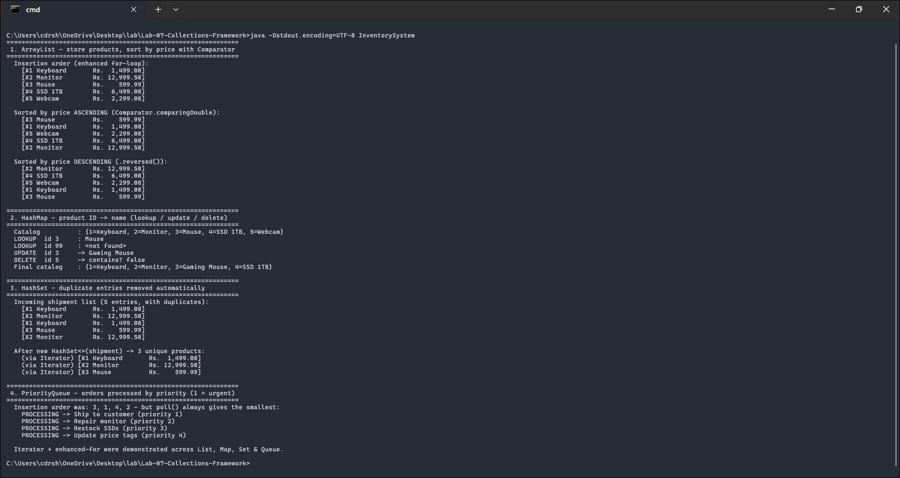

<div align="center">

# 📦 Lab 07 — Collections Framework (Inventory Management)

### *ArrayList + Comparator · HashMap · HashSet · PriorityQueue · Iterator & enhanced for*


</div>

---

## 🎯 Aim

Implement a simple **inventory management system** using:

| # | Collection | Job in the system |
|---|-----------|-------------------|
| 1 | `ArrayList` | Store products, **sort by price** with a `Comparator` |
| 2 | `HashMap` | Product **ID → name** pairs with lookup / update / delete |
| 3 | `HashSet` | **Remove duplicate** entries from a shipment |
| 4 | `PriorityQueue` | Process orders **by priority** |
| ✚ | `Iterator` + enhanced for-loop | Demonstrated **across all** collections |

---

## 📁 Files

| File | Purpose |
|------|---------|
| `InventorySystem.java` | `Product`, `Order` + the four-part driver |
| `output.txt` | Actual captured program output |
| `README.md` | You are here 👋 |

---

## ⚙️ How to Run

```bash
javac InventorySystem.java
java InventorySystem
```

---

## 🔍 How the Code Works

### 1️⃣ `ArrayList` + `Comparator` — sorting without touching the class

```java
products.sort(Comparator.comparingDouble(p -> p.price));              // ascending
products.sort(Comparator.comparingDouble((Product p) -> p.price).reversed()); // descending
```

> 💡 `Comparator` keeps ordering **outside** the `Product` class — tomorrow you can sort by name or id without editing `Product` (unlike `Comparable`, which bakes in a single "natural" order).

### 2️⃣ `HashMap` — O(1) catalog operations

```java
catalog.get(3);                         // lookup
catalog.getOrDefault(99, "<not found>") // safe lookup for a missing key
catalog.put(3, "Gaming Mouse");         // UPDATE — same key overwrites the value
catalog.remove(5);                      // delete
```

### 3️⃣ `HashSet` — duplicates vanish on construction

```java
Set<Product> unique = new HashSet<>(shipment);   // 5 entries in → 3 out
```

This only works because `Product` overrides **`equals()` and `hashCode()`** (based on `id`). Without them, every object would look "unique" to the set — a classic exam trap. The set is then walked with an explicit **`Iterator`**.

### 4️⃣ `PriorityQueue` — the heap decides the order

```java
Queue<Order> q = new PriorityQueue<>(Comparator.comparingInt(o -> o.priority));
q.poll();   // ALWAYS returns the lowest priority number, not the oldest entry
```

---

## 📸 Live Terminal Screenshot

> Genuine screenshot of `InventorySystem` compiled with `javac` and run in Windows Terminal on Windows 11 (JDK 17) — not a mock-up.



---

## 📟 Output (actual run)

```text
  Sorted by price ASCENDING (Comparator.comparingDouble):
    [#3 Mouse          Rs.    599.99]
    [#1 Keyboard       Rs.  1,499.00]
    [#5 Webcam         Rs.  2,299.00]
    [#4 SSD 1TB        Rs.  6,499.00]
    [#2 Monitor        Rs. 12,999.50]

  LOOKUP  id 3     : Mouse
  LOOKUP  id 99    : <not found>
  UPDATE  id 3     -> Gaming Mouse
  DELETE  id 5     -> contains? false

  Incoming shipment list (5 entries, with duplicates):
  After new HashSet<>(shipment) -> 3 unique products

  Insertion order was: 3, 1, 4, 2 — but poll() always gives the smallest:
    PROCESSING -> Ship to customer (priority 1)
    PROCESSING -> Repair monitor (priority 2)
    PROCESSING -> Restock SSDs (priority 3)
    PROCESSING -> Update price tags (priority 4)
```

<details>
<summary>📜 <b>Click for the FULL captured output</b> (also in <code>output.txt</code>)</summary>

See [`output.txt`](./output.txt) — insertion order, both sort directions, the full map/set walkthroughs and the queue drain.

</details>

### 🧾 What the output proves

| Observation | Concept verified |
|-------------|------------------|
| Mouse → Monitor ascending, then reversed | `Comparator` + `.reversed()` control list order externally |
| `put` on existing key 3 changed its value | HashMap update = overwrite by key |
| 5 shipment entries → 3 unique | `HashSet` + correct `equals`/`hashCode` deduplicate automatically |
| Orders processed 1→2→3→4 despite insertion 3,1,4,2 | `PriorityQueue` is a heap, not a FIFO queue |

---

## 🎤 Viva-Voce Quick Prep

| Question | Answer |
|----------|--------|
| `Comparable` vs `Comparator`? | `Comparable` = one natural order inside the class; `Comparator` = any number of external orders. |
| Why override both `equals()` AND `hashCode()`? | `HashSet`/`HashMap` find the bucket by `hashCode`, then confirm with `equals` — break one and dedup/lookup breaks. |
| Is `PriorityQueue` iteration ordered? | No! Only `poll()/peek()` respect priority; iteration order is the heap's internal layout. |
| `ArrayList` vs `LinkedList`? | ArrayList: O(1) random access, slow middle inserts; LinkedList: the reverse. |
