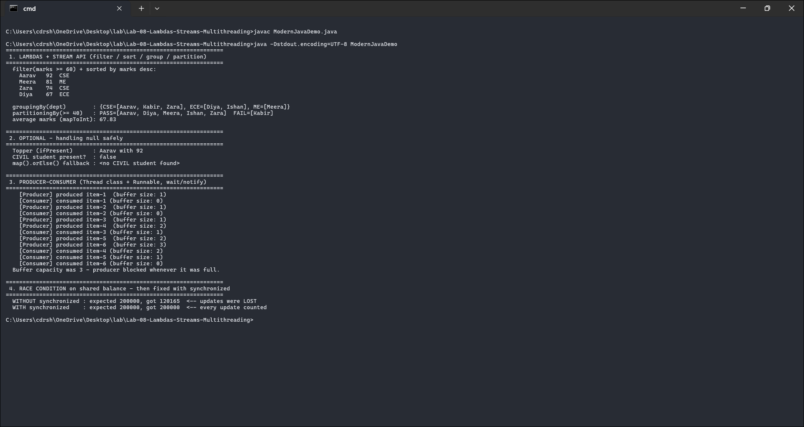

# Lab 08 - Lambdas, Streams and Multithreading

Four parts: stream operations on student objects (filter, sort, groupingBy, partitioningBy), `Optional` for handling missing values, a producer-consumer with threads, and a shared bank balance that shows a race condition and then fixes it with `synchronized`.

Course outcome CO4 (Java 8 features and multithreaded programs), Bloom level K4.

## Files

- `ModernJavaDemo.java` - all four parts
- `output.txt` - console output from an actual run
- `screenshots/output-1.png` - screenshot of it running

## Running it

```
javac ModernJavaDemo.java
java ModernJavaDemo
```

## How the code works

**Streams.** A list of students is filtered by marks, sorted, and grouped two ways. `groupingBy(dept)` makes one bucket per department, so the number of buckets depends on the data. `partitioningBy` always makes exactly two buckets, true and false - here, pass and fail. Running both side by side is the point: they look similar but one splits into N groups and the other into exactly two.

**Optional.** Looking for a student in a department that doesn't exist returns an empty `Optional`. The code chains `map` and `orElse` onto it, so the empty case flows straight through to a fallback string instead of throwing a `NullPointerException`. No null checks needed.

**Producer-consumer.** A buffer with capacity 3, a fast producer, and a slower consumer, coordinated with `wait()` and `notifyAll()` inside synchronized methods. When the buffer is full the producer waits; when it's empty the consumer waits. The `wait()` calls sit inside `while` loops rather than `if`, which guards against spurious wakeups.

**Race condition.** Two threads each add 1 to a shared balance 100,000 times, so the total should be 200,000. The unsynchronized version loses updates because `balance = balance + 1` is really three steps (read, add, write) and the threads interleave between them. The `synchronized` version makes that operation atomic and always lands on 200,000.

## Screenshot



In this particular capture the unsynchronized total came out 120,165. That number is different every run - the fact that it's unpredictable is itself the evidence of a race condition. The synchronized total is always exactly 200,000.

## Output

```text
  groupingBy(dept)        : {CSE=[Aarav, Kabir, Zara], ECE=[Diya, Ishan], ME=[Meera]}
  partitioningBy(>= 40)   : PASS=[Aarav, Diya, Meera, Ishan, Zara]  FAIL=[Kabir]

  CIVIL student present?  : false
  map().orElse() fallback : <no CIVIL student found>

    [Producer] produced item-1  (buffer size: 1)
    [Consumer] consumed item-1 (buffer size: 0)
    ...

  WITHOUT synchronized : expected 200000, got 120165  <-- updates were LOST
  WITH synchronized    : expected 200000, got 200000  <-- every update counted
```

Three department buckets versus exactly two pass/fail buckets; the missing CIVIL student gives a fallback string instead of a crash; the producer never lets the buffer exceed 3; and the race condition is real (120,165 is not 200,000) and fixed by `synchronized`.

## Likely viva questions

- **What is a functional interface?** An interface with exactly one abstract method, like `Runnable` or `Comparator` - the target type of a lambda.
- **Why `while` around `wait()` instead of `if`?** Spurious wakeups and multiple waiters mean the condition has to be rechecked after waking.
- **Why does `balance + 1` race?** It's read, add, write - three steps, and another thread can slip in between and overwrite the result.
- **start() vs run()?** `start()` spawns a new thread that calls `run()`; calling `run()` directly just runs it on the current thread.
