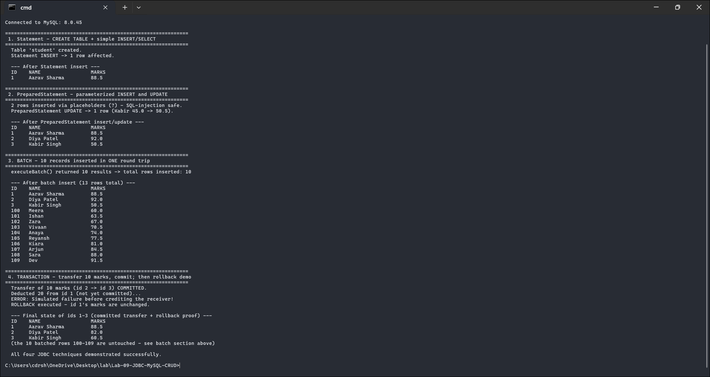

<div align="center">

# 🗄️ Lab 09 — JDBC: MySQL CRUD on a Student Table

### *Statement · PreparedStatement · Batch insert ×10 · Transactions (commit / rollback) · ResultSet*


</div>

---

## 🎯 Aim

Connect a Java application to **MySQL**, create a `student` table and implement **full CRUD** using:

| # | Technique | What it demonstrates |
|---|-----------|----------------------|
| 1 | `Statement` | Simple, fixed SQL (DDL + one insert) |
| 2 | `PreparedStatement` | Parameterized (`?`) INSERT & UPDATE — precompiled + SQL-injection safe |
| 3 | **Batch processing** | 10 records queued with `addBatch()`, sent in **one** round trip |
| 4 | **Transactions** | Transfer marks between records — `commit()` on success, `rollback()` on failure |
| ✚ | `ResultSet` | Cursor-based row display after every stage |

---

## 📁 Files

| File | Purpose |
|------|---------|
| `StudentJDBC.java` | Complete, runnable JDBC program (all 4 techniques) |
| `output.txt` | **Real captured output** from a live run against MySQL |
| `README.md` | You are here 👋 |

> ✅ **Verified live:** this program was compiled and executed against a running **MySQL 8.0.45** server (database `college`, user `labuser`) using **MySQL Connector/J 8.4.0**. The screenshot and `output.txt` below are the genuine result — the `college` database and student rows were really created, inserted, updated, batched and transacted.

---

## ⚙️ Setup & Run (one time)

```sql
-- 1. In MySQL, create the database and a lab user (one time):
CREATE DATABASE college;
CREATE USER 'labuser'@'localhost' IDENTIFIED BY 'lab123';
GRANT ALL PRIVILEGES ON college.* TO 'labuser'@'localhost';
FLUSH PRIVILEGES;
```

```bash
# 2. Download MySQL Connector/J (mysql-connector-j-8.4.0.jar) from dev.mysql.com
#    (this repo keeps it in ../lib). Then compile and run:
javac StudentJDBC.java

# Windows (the ';' is the classpath separator):
java -cp ".;../lib/mysql-connector-j-8.4.0.jar" StudentJDBC
# Linux / macOS (use ':' instead):
java -cp ".:../lib/mysql-connector-j-8.4.0.jar" StudentJDBC
```

> The program connects as `labuser` / `lab123`; the URL uses `?createDatabaseIfNotExist=true` so the `college` schema is auto-created if missing. Edit the `USER` / `PASS` constants at the top of `StudentJDBC.java` to match your own MySQL setup.

---

## 🔍 How the Code Works

### 1️⃣ `Statement` — fixed SQL
```java
st.executeUpdate("CREATE TABLE student (id INT PRIMARY KEY, ...)");
st.executeUpdate("INSERT INTO student VALUES (1, 'Aarav Sharma', 88.5)");
```
Fine for DDL and one-off queries — but values are glued into the SQL string, which is where SQL injection lives.

### 2️⃣ `PreparedStatement` — placeholders
```java
PreparedStatement ps = con.prepareStatement(
    "INSERT INTO student (id, name, marks) VALUES (?, ?, ?)");
ps.setInt(1, 2);  ps.setString(2, "Diya Patel");  ps.setDouble(3, 92.0);
ps.executeUpdate();
```
The SQL is **precompiled once**; values travel separately as typed parameters → faster on repeats and injection-proof.

### 3️⃣ Batch — 10 inserts, 1 network trip
```java
for (int i = 0; i < 10; i++) { ps.setInt(1, 100+i); ...; ps.addBatch(); }
int[] counts = ps.executeBatch();   // all 10 fired together
```

### 4️⃣ Transactions — all or nothing
```java
con.setAutoCommit(false);              // take manual control
take.executeUpdate();                  // -10 marks from id 2
give.executeUpdate();                  // +10 marks to id 3
con.commit();                          // ✅ both become permanent together

// … second transfer deliberately fails mid-way …
con.rollback();                        // ⏪ the uncommitted deduction is UNDONE
```
> 💡 This is the bank-transfer property: **either both updates happen or neither does.** The demo deliberately throws after the deduction to prove `rollback()` restores the row.

### `ResultSet` — reading rows
```java
ResultSet rs = st.executeQuery("SELECT id, name, marks FROM student ORDER BY id");
while (rs.next())                       // cursor moves row by row
    rs.getInt("id"); rs.getString("name"); rs.getDouble("marks");
```

---

## 📸 Live Terminal Screenshot (real MySQL run)

> Genuine screenshot of `StudentJDBC` running against **MySQL 8.0.45** in Windows Terminal on Windows 11 — the `college` database and `student` table were really created, populated, batched and transacted.



---

## 📟 Output (live run — full version in `output.txt`)

```text
Connected to MySQL: 8.0.45

 1. Statement - CREATE TABLE + simple INSERT/SELECT
  Table 'student' created.
  Statement INSERT -> 1 row affected.

 2. PreparedStatement - parameterized INSERT and UPDATE
  2 rows inserted via placeholders (?) - SQL-injection safe.
  PreparedStatement UPDATE -> 1 row (Kabir 45.0 -> 50.5).

 3. BATCH - 10 records inserted in ONE round trip
  executeBatch() returned 10 results -> total rows inserted: 10

 4. TRANSACTION - transfer 10 marks, commit; then rollback demo
  Transfer of 10 marks (id 2 -> id 3) COMMITTED.
  Deducted 20 from id 1 (not yet committed)...
  ERROR: Simulated failure before crediting the receiver!
  ROLLBACK executed - id 1's marks are unchanged.

  --- Final state of ids 1-3 (committed transfer + rollback proof) ---
  1   Aarav Sharma   88.5     <- rollback worked (the -20 was undone)
  2   Diya Patel     82.0     <- gave 10 marks  (92.0 -> 82.0)
  3   Kabir Singh    60.5     <- received 10    (50.5 -> 60.5)
```

### 🧾 What the output proves
- **Diya 92.0 → 82.0** and **Kabir 50.5 → 60.5**: the committed transfer moved exactly 10 marks between two real database rows.
- **Aarav stays 88.5** even though 20 was deducted mid-transaction: `rollback()` erased the uncommitted change.
- **13 rows after batch** (3 individual + 10 batched): `executeBatch()` really inserted all ten in one round trip.

---

## 🎤 Viva-Voce Quick Prep

| Question | Answer |
|----------|--------|
| Why PreparedStatement over Statement? | Precompiled (faster when reused) + parameters are data, never SQL → injection-proof. |
| What does `setAutoCommit(false)` do? | Stops each statement committing itself; changes wait for your explicit `commit()`/`rollback()`. |
| What are ACID properties? | Atomicity, Consistency, Isolation, Durability — the transaction demo shows Atomicity. |
| What does `executeBatch()` return? | An `int[]` of per-statement update counts. |
| Which JDBC driver type is Connector/J? | Type 4 — pure-Java "thin" driver speaking MySQL's wire protocol directly. |
