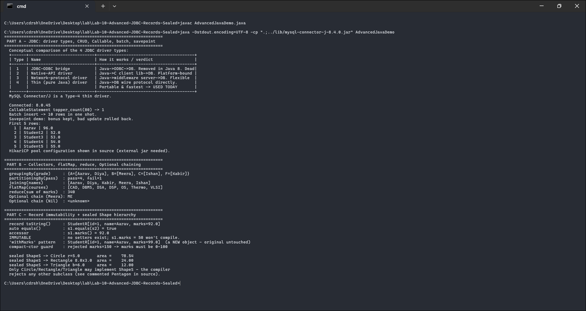

# Lab 10 - Advanced JDBC, Records and Sealed Classes

Three parts. Part A covers advanced JDBC: the four driver types, a `CallableStatement`, a batch insert, a transaction with a savepoint, and the HikariCP pool setup. Part B covers advanced stream collectors. Part C covers records and sealed classes.

Course outcome CO5 (database-connected Java plus advanced features including records and sealed classes), Bloom level K4.

Everything ran for real. Parts B and C are plain Java 17; Part A connected to a running MySQL 8.0.45 server via Connector/J 8.4.0 (database `college`, user `labuser`) and actually ran the stored procedure, batch, and savepoint transaction.

## Files

- `AdvancedJavaDemo.java` - all three parts
- `output.txt` - captured output from the live run
- `screenshots/output-1.png` - screenshot of it running

## Running it

```
javac AdvancedJavaDemo.java

# Parts B and C run on a plain JDK. Part A also needs the driver on the classpath:
java -cp ".;../lib/mysql-connector-j-8.4.0.jar" AdvancedJavaDemo
```

Use `:` instead of `;` on Linux or macOS. It uses the same `labuser` / `lab123` login and `college` database as Lab 09 (see that README for the one-time setup). If MySQL isn't reachable, Part A prints a notice and the program carries on with Parts B and C.

## How the code works

**Part A - JDBC.** The four driver types are printed as a comparison table; the short version is that Type 4 (a pure-Java "thin" driver like Connector/J) is what everyone uses now. `CallableStatement` runs a stored procedure that takes an input and returns a count through an OUT parameter. A savepoint is a bookmark inside a transaction - the code makes a good change, sets a savepoint, makes a bad change, rolls back to the savepoint, and commits, so the good change survives and the bad one doesn't. The HikariCP connection pool is set up in a commented block (it needs its own jar); a pool keeps warm connections ready, which is much faster than opening a fresh one per query.

**Part B - collectors.** `groupingBy` groups students by grade, `partitioningBy` splits them pass/fail, `joining` concatenates names into one string, `flatMap` flattens each student's list of courses into a single stream, `reduce` sums the marks, and a chain of `Optional` methods safely fetches a student's department with a fallback.

**Part C - records and sealed classes.** `StudentR` is a record, so one line gives you private final fields, a constructor, accessors, `equals`, `hashCode`, and `toString`. It has no setters - to "change" marks you build a new record. A compact constructor validates the marks and rejects anything outside 0-100. `ShapeS` is a sealed interface that permits only `CircleS`, `RectangleS`, and `TriangleS`, so no other class can implement it. The source has a commented-out `Pentagon` that shows the compile error you'd get.

## Screenshot



## Output

```text
  Connected: 8.0.45
  CallableStatement topper_count(80) -> 1
  Batch insert -> 10 rows in one shot.
  Savepoint demo: bonus kept, bad update rolled back.

  groupingBy(grade)     : {A=[Aarav, Diya], B=[Meera], C=[Ishan], F=[Kabir]}
  partitioningBy(pass)  : pass=4, fail=1
  joining(names)        : [Aarav, Diya, Kabir, Meera, Ishan]
  flatMap(courses)      : [CAD, DBMS, DSA, DSP, OS, Thermo, VLSI]
  reduce(sum of marks)  : 340
  Optional chain (Meera): ME

  record toString()     : StudentR[id=1, name=Aarav, marks=92.0]
  auto equals()         : s1.equals(s2) = true
  compact-ctor guard    : rejected marks=150 -> marks must be 0-100

  sealed ShapeS -> Circle r=5.0        area =    78.54
  sealed ShapeS -> Rectangle 8.0x3.0   area =    24.00
  sealed ShapeS -> Triangle b=6.0      area =    12.00
```

Four grade buckets versus exactly two pass/fail partitions; seven distinct courses flattened out of five nested lists; two separate record objects compare equal because records generate value-based `equals`; and `marks=150` is rejected at construction.

## Likely viva questions

- **Record vs regular class?** A record is an immutable data carrier with generated constructor, accessors, `equals`, `hashCode`, and `toString`. A regular class is all manual.
- **Can a record have setters?** No, the fields are final. You make a new record to change a value.
- **Why seal a hierarchy?** The compiler knows every possible subtype, which makes switches and `instanceof` chains exhaustive and the model safer.
- **CallableStatement vs PreparedStatement?** `CallableStatement` invokes stored procedures and supports OUT parameters; `PreparedStatement` runs parameterized SQL.
- **Savepoint vs rollback?** `rollback()` undoes the whole transaction; `rollback(savepoint)` undoes only back to the bookmark.
- **Why use a connection pool?** Opening a database connection is expensive, so a pool reuses warm ones.
